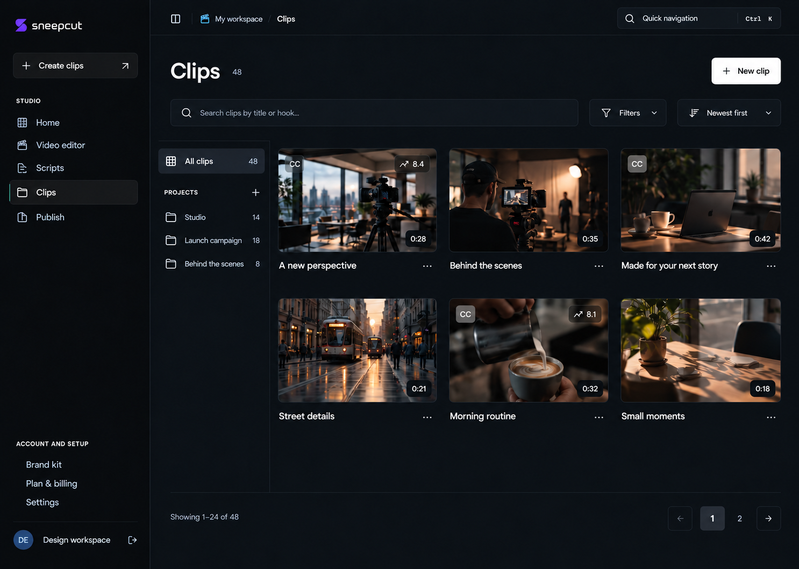
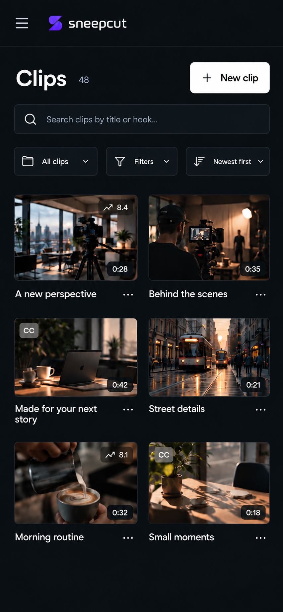
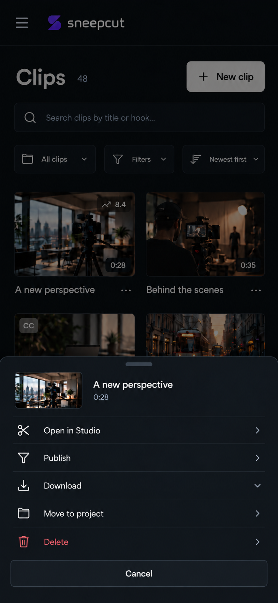

# Clips design mockups

These screens extend the approved Sneep Cut visual language. They are design images, not screenshots of implemented UI. Grounding used the existing desktop/mobile library screenshots, current route/component behavior and the approved New post reference.

## Desktop

Compact Clips heading, New clip action, search, grouped filters, sorting, a narrow project rail and a three-column gallery. Default cards keep the thumbnail, duration, short title, overflow and selected existing score/subtitle indicators. Repeated technical metadata and hook text are omitted from the browsing view. Preserve their data and relevant detail access during implementation.

## Mobile

Two-column gallery with compact project selector, search, filters and sort. This viewport shows only the visible cards; it does not change the existing 24-clips-per-page contract.

## Clip actions on mobile

The user explicitly confirmed that the four original actions may remain in the three-dot menu: Open in Studio, Publish, Download and Delete. Do not remove those functions or restore a four-button matrix merely because an older screenshot showed it. Move to project can expose existing organization behavior accessibly. Delete still requires confirmation; this image only opens the menu.

## Behavior to preserve

- Thumbnail/title/Open in Studio use the authenticated Studio launcher.
- Publish opens New post prefilled with the clip.
- Download respects available media/export variants; Delete retains confirmation, API mutation and reload behavior.
- Preserve project creation/management, clip movement, search, organization/score/aspect/subtitle filters, sorting, clear filters, URL query state and 24-item pagination.
- Preserve loading, errors/retry, empty library, empty project, no matches and missing-thumbnail states.
- Preserve dashboard layout identity and component Fast Refresh when implementing.

Generated using built-in Image Gen. Prompt set: match the approved minimal dark Sneep Cut design; reduce repeated labels and metadata; keep existing clip actions in overflow; render desktop library, responsive phone library and phone action sheet. Desktop target 1440 x 1024; phone target 390 x 844. The first desktop exploration with metadata rows is superseded by the cleaner image above.

Notion: https://app.notion.com/p/401c7071a19881488fbae58675f7550e
