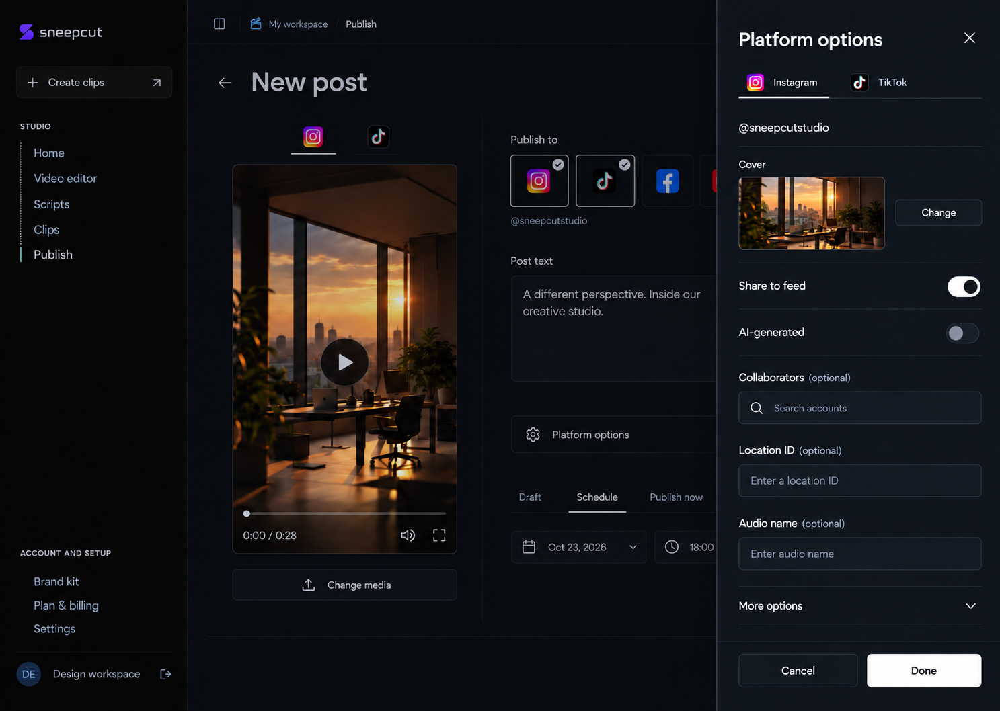
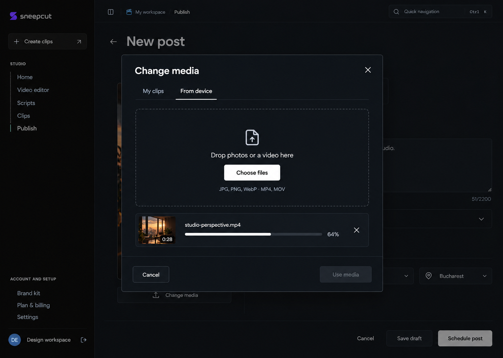
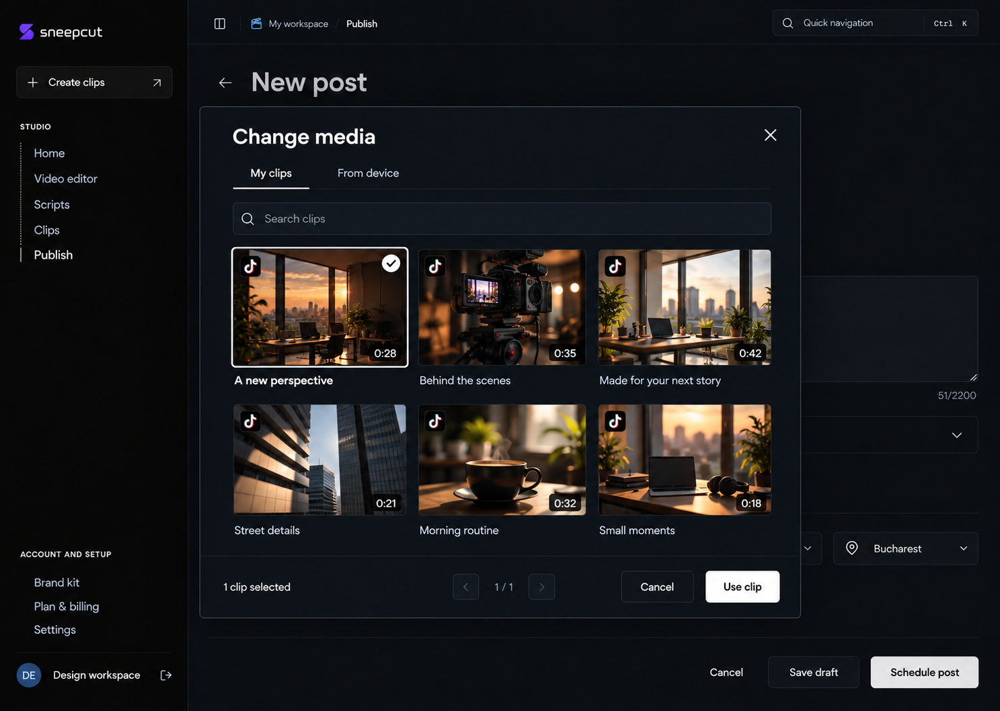
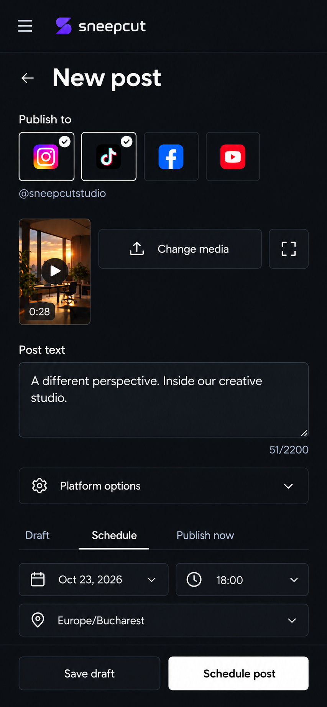
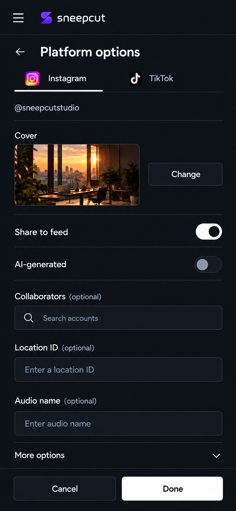
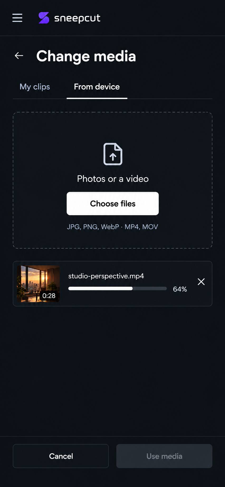
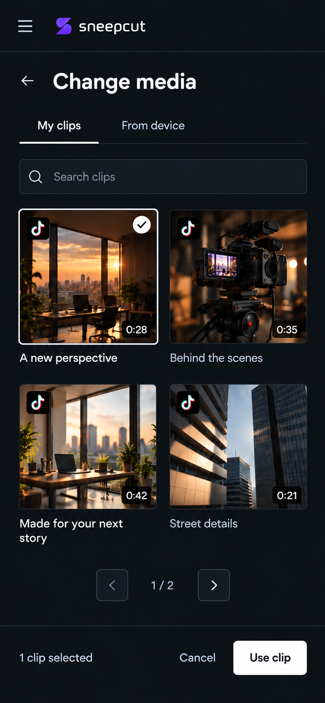

# New post interaction mockups

Generated on 2026-10-22 from the user-approved [New post reference](../assets/new-post-approved-2026-10-22.png). These are seven interaction states of the same design, not seven alternative directions. They are image mockups, not implemented or functionally verified UI.

## Desktop

### Platform options

Instagram Reel preferences are shown. The TikTok tab represents a separate provider-specific view; it must retain creator restrictions and consent during implementation. Collaborators are entered as usernames; the mockup's Search accounts placeholder does not imply a new account-discovery API.

### Upload from device

Change media exposes both My clips and From device. This state illustrates one video upload in progress, with Use media disabled until it finishes. Accepted types must reflect selected platforms, rather than promise every generic upload type is publishable.

### Choose a generated platform clip

Search and paging expose the generated clip library. Clip selection is single-select; choosing a clip replaces device-uploaded media. Metadata is limited to existing fields such as thumbnail, title, duration and eligibility.

## Mobile

### New post

The main form uses one public post-text field, compact selected-media preview, destination icons, platform options and scheduling controls.

### Platform options

A focused scrollable view keeps provider controls readable and Done accessible.

### Upload from this phone

Choose files will invoke the phone's native picker during implementation. This image shows the application view and upload progress, not an imitation or verification of an OS picker.

### Choose a generated platform clip

A two-column library retains search, paging, selection and From device access. Returning to New post must preserve draft text and settings.

## Generation and verification notes

- Generated with the built-in Image Gen tool. The selected New post image was attached to every generation; relevant desktop and mobile states were also attached to responsive generations.
- Prompt set: preserve the approved minimal dark Sneep Cut style, one public text field, neutral interactions and shared small radii; render one state per image. Desktop prompts targeted 1440 x 1024 and phone prompts 390 x 844. Returned raster dimensions may be proportionally higher; these are visual concepts, not CSS measurements.
- No new native, account-search, cloud-storage or camera-permission capabilities are implied by the mockups.
- Keep the real API validation, provider-specific consent and media compatibility rules when implementing. File-picker behavior, accessibility, actual responsive rendering and Fast Refresh require later checks against the coded interface.
- The user's selected design is durably recorded in the repository guide, AGENTS.md and local Product Design context.

Notion tracking: https://app.notion.com/p/401c7071a1988160b8bfc1c24512641c
