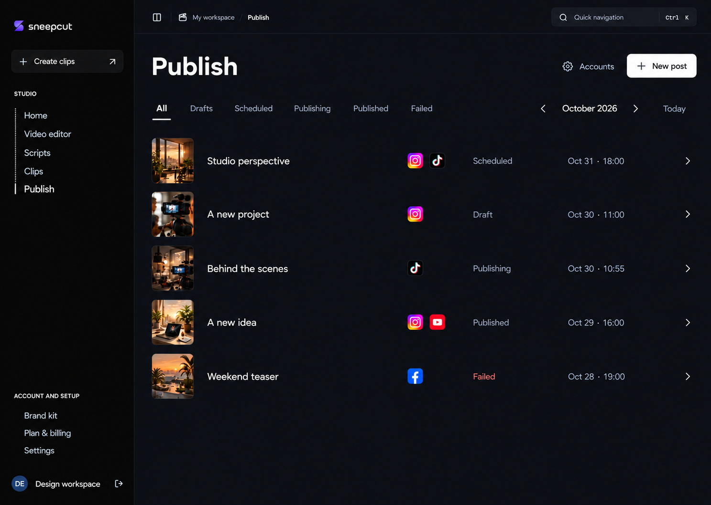
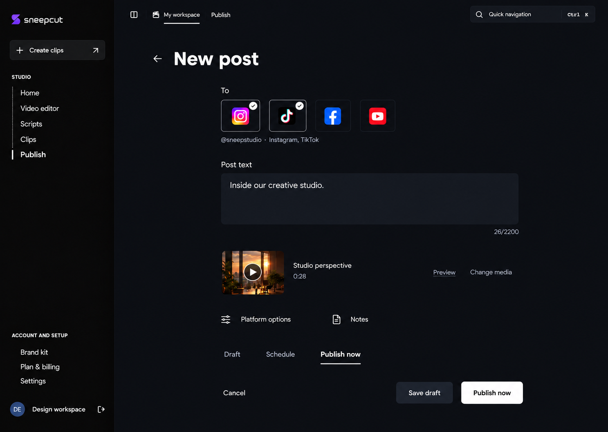
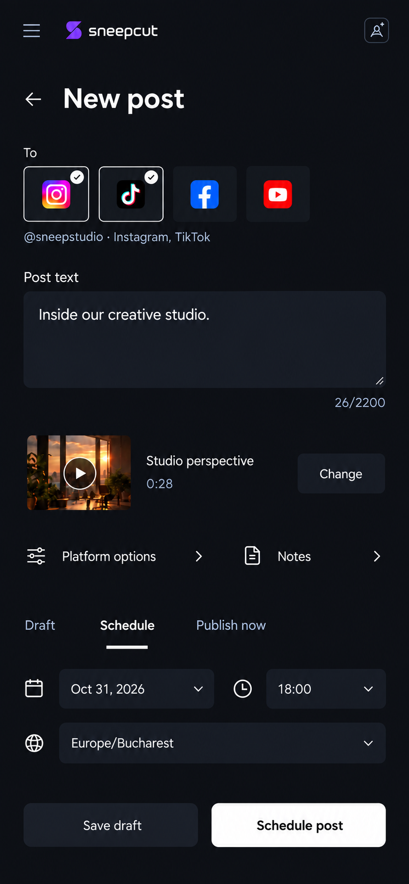
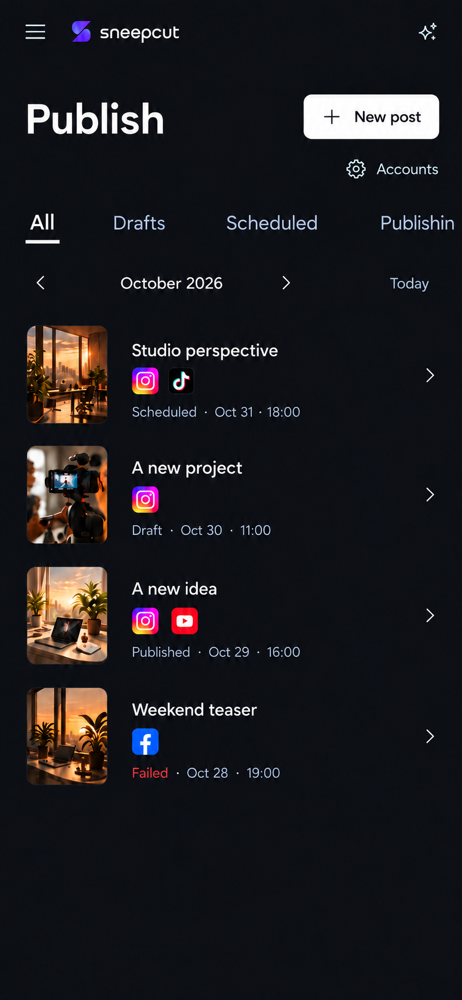
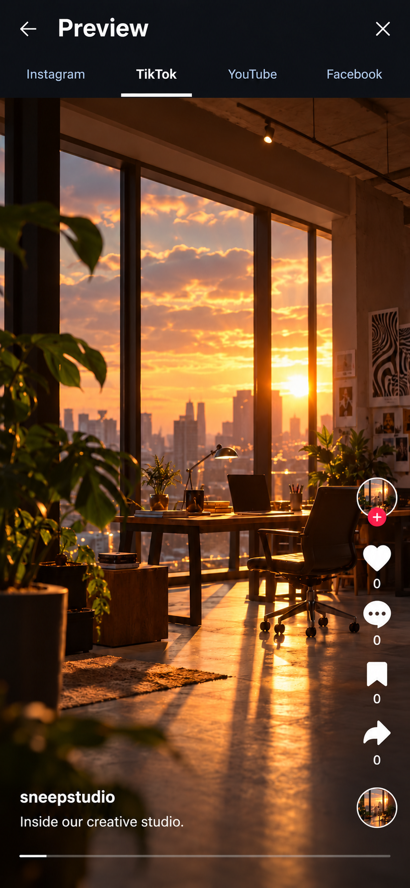
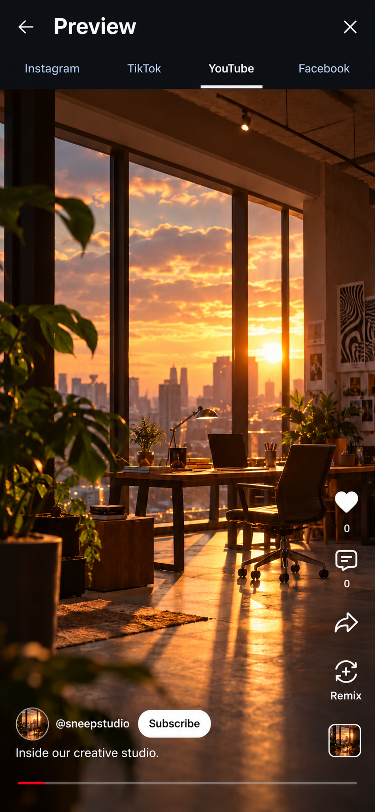
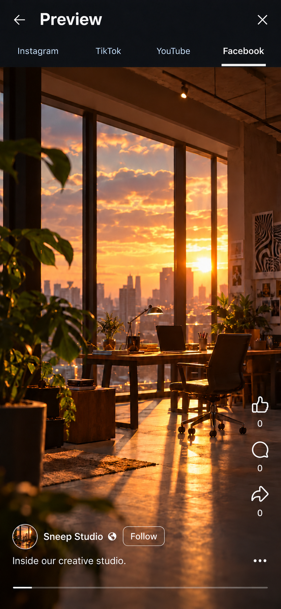

# Publish — model simplificat, revizia 3

**30 octombrie 2026 · machete pentru review, neimplementate.**

[Deschide Publish desktop](01-publish-desktop.png). **All este implicit**, urmat de Drafts, Scheduled, Publishing, Published și Failed. Lista include toate statusurile din luna afișată. Rândurile și secțiunile sunt separate prin spațiu; bordurile rămân rare.

New post păstrează o singură coloană, un text public și media compactă. Opțiunile existente apar la cerere. Preview-ul extins folosește suprapuneri distincte pentru fiecare platformă, inclusiv apreciere, comentarii și distribuire.

## Ecrane principale

| Ecran | Imagine |
| --- | --- |
| Publish desktop — All | [Deschide](01-publish-desktop.png) |
| New post desktop | [Deschide](02-new-post-desktop.png) |
| New post mobil — Schedule | [Deschide](03-new-post-mobile.png) |
| Publish mobil — All | [Deschide](04-publish-mobile.png) |

## Preview-uri sociale

Aceste patru stări arată un **video vertical**, cu aceeași media și același caption sintetic. Ele reproduc suprapunerile postării, în cadrul Preview Sneep Cut, fără navigația globală a aplicației sociale.

| Platformă | Imagine | Comenzi vizuale principale |
| --- | --- | --- |
| Instagram Reels | [Deschide](05-instagram-preview.png) | Inimă, comentarii, repost, distribuire, meniu, audio |
| TikTok video | [Deschide](06-tiktok-preview.png) | Profil/follow, inimă, comentarii, salvare, distribuire, audio |
| YouTube Shorts | [Deschide](07-youtube-preview.png) | Inimă, comentarii, distribuire, Remix, audio |
| Facebook Reels | [Deschide](08-facebook-preview.png) | Thumbs-up, comentarii, distribuire, meniu |

Controalele sociale sunt context vizual, nu acțiuni noi asupra conturilor. Numărătorile 0 sunt demonstrative. Fidelitatea se raportează la [referințele oficiale inspectate](PLATFORM-PREVIEWS.md), nu la toate versiunile aplicațiilor. Fotografiile, caruselele și video-ul YouTube obișnuit au reguli separate în specificație; geometria lor exactă nu este certificată de aceste machete video.

## Specificație

| Document | Rol |
| --- | --- |
| [DESIGN.md](DESIGN.md) | Structură, text, tokens, responsive și interacțiuni |
| [FUNCTIONALITY.md](FUNCTIONALITY.md) | Funcțiile reale Publish, conturi, status, erori și ștergere |
| [COMPOSER.md](COMPOSER.md) | Media, setări și consimțăminte pentru fiecare provider |
| [PLATFORM-PREVIEWS.md](PLATFORM-PREVIEWS.md) | Surse oficiale, format media și contractul preview-urilor |
| [SOURCES.md](SOURCES.md) | Fișierele DESIGN.md din ambele colecții și adaptările |
| [PROMPTS.md](PROMPTS.md) | Prompturile exacte și referințele generării |
| [VERIFICATION.md](VERIFICATION.md) | Verificări și limite |

Opt imagini complementare ale aceluiași model. Versiunile anterioare respinse nu sunt ținte de implementare. Stările upload, opțiuni provider, validare, progres, empty/loading/error și ștergere sunt documentate în inventare, fără a încărca ecranul implicit.

Generare prin Image Gen integrat. Rasterele ilustrează compoziția; fonturile, iconurile, razele și dimensiunile din produs se verifică în implementare. Nu s-a modificat codul aplicației.

Tichetul reviziei: [Sneep Cut > IT](https://app.notion.com/p/409c7071a1988111a03ccf9d56075aec).
